# 09 — Sistema Visual

**Projeto:** Growth Intelligence Hub (GIH)
**Sprint:** pós-S08 — história **H103** (a versão 1, da H08, ficou na etiqueta `interface-v1`)
**Versão:** 2.0 — 22/10/2026 · o sistema "Etiqueta e Lacre", que substitui o da versão 1 (1.0 — 15/09/2026)
**Status:** ⏳ aguardando aprovação da equipe, na issue #241 (H103)

> **Este documento é portão.** A interface nova só entra na `main` com a direção visual aprovada pela equipe,
> registrada na issue #241 (H103) — como a primeira foi, na #8. Num projeto anterior do mesmo domínio, "tema
> escuro e elegante" foi tratado como especificação suficiente e o redesign inteiro foi rejeitado depois de
> pronto. Validar antes custa uma conversa.

**Por que uma versão 2.** A interface da versão 1 funcionava, e passava em toda medição; o problema era o que
ela não dizia ao olho. A letra condensada cansava quem lê muito, o rótulo em maiúsculas espaçadas competia
com o dado, e a pessoa se perdia entre as telas: nada dizia em que área do sistema ela estava. A versão 2
mantém o comportamento — os mesmos 29 endereços, as mesmas 78 operações da API, as mesmas permissões — e troca
a camada visual inteira. Ela foi testada antes de chegar aqui, num laboratório fora do repositório, com a API
de verdade e uma conta de cada perfil.

**Como ver.** A versão 2 é a própria `web/`; as capturas de cada tela, nos dois temas, estão em
[`docs/medicoes/telas/`](medicoes/telas/). A versão 1 volta com `git checkout interface-v1 -- web/`.

---

## 1. As regras que não se negociam

### 1.1 Cada cor tem um trabalho só

| Cor | Significa | E nada mais |
|---|---|---|
| **Cobalto** (`--acao`) | responde ao seu clique: botão, link, seleção, foco do controle | não é dado, gráfico, área, título nem estado |
| **Amarelo lacre** (`--lacre`) | decisão gravada ou valor medido que a pessoa precisa reconhecer | nunca em estimativa, fundo de bloco, botão ou enfeite |
| **Cor da rota** (`--rota-*`) | a área do sistema: Análise, Previsão, Otimização, Comunicação, Administração | nunca aparece sem o nome da área; não é dado nem estado |
| **Cor do segmento** (`--seg-*`) | o segmento do parceiro, um dos seis da RN01 | nunca aparece sem o nome do segmento |
| **Vermelho** (`--erro`) | erro | abstenção, vazio e indisponível não são erro, e não são vermelhos |

**O que mudou da versão 1.** Lá, o segmento era um ponto colorido e um rótulo neutro, e a cor de segmento
nunca ia para o fundo. Aqui, o segmento é uma **etiqueta tingida**: o fundo claro do matiz, a tinta escura do
mesmo matiz e o ponto na cor plena. A regra que importa continua: a cor nunca aparece sozinha — o nome do
segmento está sempre escrito dentro dela, e a etiqueta tem o mesmo desenho para os seis. A mudança veio de quem
usa: numa lista de 25 parceiros, o tom da etiqueta deixa achar os "Em risco" de relance, e o nome confirma.

Se você for acrescentar `--acao` em algo que não responde a clique, a cor errada está sendo usada.

### 1.2 Medido é lacrado; estimativa é tracejada

O que foi medido ou decidido — o plano calculado, a mensagem aprovada, os limiares em vigor, a versão do modelo
em uso — sai com o **lacre**: o número, quem e quando. O que é previsão do modelo sai **sem lacre**: contorno
tracejado no bloco e no indicador, a etiqueta "Estimativa", trecho tracejado e marcador vazado no gráfico.
Cor diferente sozinha não bastaria (H44).

### 1.3 Hierarquia vem do tamanho do número e da rota, e não de camadas

As superfícies são planas e pousadas: o chão cinza-frio, as etiquetas brancas com uma sombra curta, e nada
flutua. O que guia o olho é o número principal em 750, grande, a faixa na cor da rota no topo do indicador
e o cabeçalho, que diz em que área a pessoa está e o caminho de volta. Na tabela de parceiros, o nome é o único
elemento em peso alto da linha.

---

## 2. Cor

Os valores saem de `web/src/estilos/tokens.css` (e a tinta sobre o cobalto, de `base.css`). O escuro é o lado
de dentro da bolsa térmica: o chão quase preto, as etiquetas em grafite; o lacre e as cores vivas das rotas
não mudam. O escuro do sistema e o escuro escolhido são a mesma paleta — o teste de contraste confere.

### Superfícies, tinta e ação

| Papel | Token | Claro | Escuro |
|---|---|---|---|
| Chão da página (o balcão) | `--chao` | `#eef0f2` | `#0b0c0e` |
| Etiqueta: bloco, indicador, folha, campo | `--etiqueta` | `#ffffff` | `#17191c` |
| Etiqueta sombreada: hover de linha, desativado | `--etiqueta-2` | `#f6f7f8` | `#1e2125` |
| Tinta principal | `--carbono` | `#141414` | `#f1f2f4` |
| Tinta de apoio | `--carbono-2` | `#50555c` | `#a7adb5` |
| Tinta de ausente e desativado | `--carbono-3` | `#6b7178` | `#8d939b` |
| Fio: divisória e linha de tabela | `--fio` | `#d9dce0` | `#2b2e33` |
| Fio forte: borda de campo (3:1) | `--fio-forte` | `#8a9098` | `#7b828b` |
| **Ação** — só o que responde ao clique | `--acao` | `#1d3fe0` | `#8ea6ff` |
| Ação sob o ponteiro | `--acao-forte` | `#142fb0` | `#b3c3ff` |
| Ação, fundo fraco | `--acao-fundo` | `#e8ecff` | `#1c2547` |
| Texto sobre a ação | `--acao-tinta` | `#ffffff` | `#0b0c0e` |
| Anel de foco | `--foco` | `#1d3fe0` | `#8ea6ff` |
| **Lacre** — decisão gravada | `--lacre` | `#ffd400` | `#ffd400` |
| Texto sobre o lacre | `--lacre-tinta` | `#1a1500` | `#1a1500` |
| Trilho (náilon) | `--nailon` | `#0e0f11` | `#050506` |
| Tinta do trilho | `--nailon-tinta` | `#e6e8eb` | `#e6e8eb` |
| Dica do item do menu | `--nailon-tinta-2` | `#a3a9b1` | `#a3a9b1` |

### Estados (não são dado)

| Papel | Token | Claro | Escuro |
|---|---|---|---|
| Erro | `--erro` | `#c4162a` | `#ff7a85` |
| Erro, fundo | `--erro-fundo` | `#fdecee` | `#3a1418` |
| Sucesso | `--sucesso` | `#0b7a4f` | `#5fd69c` |
| Sucesso, fundo | `--sucesso-fundo` | `#e7f6ef` | `#0f2a1e` |
| Atenção | `--atencao` | `#8a5300` | `#f5c451` |
| Atenção, fundo | `--atencao-fundo` | `#fff4d6` | `#2e2410` |
| Neutro (vazio, indisponível), fundo | `--neutro-fundo` | `#eef1f5` | `#1e2228` |
| Variação que é boa notícia | `--variacao-boa` | `#0b7a4f` | `#5fd69c` |
| Variação que é má notícia | `--variacao-ruim` | `#b32a17` | `#ff8a73` |

### Segmentos

Na ordem de precedência da RN01. Com o nome, viram etiqueta tingida: o fundo, a tinta do mesmo matiz e o ponto na cor plena.

| Segmento | Cor plena (claro · escuro) | Fundo da etiqueta | Tinta da etiqueta |
|---|---|---|---|
| Prospecção | `#0b8f9a` · `#2cc3cf` | `#dcf6f9` · `#073236` | `#005b65` · `#a6e0e7` |
| Recém-chegado | `#c2347a` · `#f06aa9` | `#ffe6f1` · `#421d2d` | `#871951` · `#ffbad7` |
| Em risco | `#e5512d` · `#ff7350` | `#ffe7de` · `#441f16` | `#8d1d00` · `#ffbeaa` |
| Top | `#7a4bd0` · `#a98bff` | `#f2ebff` · `#2e2546` | `#563495` · `#d9c8ff` |
| Em ascensão | `#13a05f` · `#3fd08a` | `#dcf9e5` · `#0c341e` | `#006228` · `#a5e6bc` |
| Estável | `#8d939b` · `#9aa1aa` | `#eef0f3` · `#292b2e` | `#484e54` · `#d1d5da` |

### Rotas (áreas do menu)

A cor viva é a mesma nos dois temas; a forte é o traço e o texto na cor da área sobre o claro (no escuro, a própria viva).

| Área | Viva | Forte (claro · escuro) | Fundo (claro · escuro) |
|---|---|---|---|
| Análise | `#5abdf2` | `#006ca0` · `#5abdf2` | `#e6f6ff` · `#122733` |
| Previsão | `#da92e6` | `#894194` · `#da92e6` | `#fbeffc` · `#2c1e2e` |
| Otimização | `#ef9d32` | `#9b4b00` · `#ef9d32` | `#fef1e4` · `#2f2111` |
| Comunicação | `#86c660` | `#367500` · `#86c660` | `#edf7e8` · `#1d2816` |
| Administração | `#9db4ce` | `#50657e` · `#9db4ce` | `#e9f5ff` · `#172535` |

Texto sobre a cor viva: `--rota-tinta`, `#0e0f11` nos dois temas.

### Séries do benchmark (a cor segue o modo, com marcador próprio)

| Papel | Token | Claro | Escuro |
|---|---|---|---|
| Python (círculo) | `--serie-python` | `#c2347a` | `#f06aa9` |
| C++ serial (quadrado) | `--serie-cpp` | `#6b7178` | `#aab0b8` |
| OpenMP (losango) | `--serie-openmp` | `#7a4cd1` | `#a98bff` |
| GPU (triângulo) | `--serie-gpu` | `#1d8f5a` | `#3fd08a` |
| Linha da série | `--grafico-linha` | `#141414` | `#f1f2f4` |
| Grade | `--grafico-grade` | `#e7e9ec` | `#26292e` |
| Estimativa (tracejado) | `--grafico-estimativa` | `#50555c` | `#a7adb5` |

---

## 3. A paleta foi medida — e o que a medida diz

Dois instrumentos, e os dois rodam de novo a cada mudança de cor.

**O contraste de texto passa inteiro.** São 77 pares de tinta e fundo, nos dois temas, medidos do `tokens.css`
por `web/src/estilos/contraste.test.js` a cada PR, e de novo pelo `scripts/medir_telas.py`: todos passam de
4,5:1, e a borda do campo e o anel de foco, de 3:1. A medida mudou um lugar do desenho: o **carbono claro**
(`--carbono-3`, o do travessão de ausente) dá 4,32:1 sobre o chão cinza, e por isso só aparece sobre a
etiqueta (4,93:1) e a etiqueta sombreada (4,60:1). O nome na faixa refletiva da entrada passa no tom mais
escuro dela.

**A separação das cores categóricas não passa, e a interface não depende dela.** O validador de paletas da
referência de visualização (`validate_palette.js`) mede quanto duas cores se distinguem com daltonismo e com
visão normal. As três famílias da versão 2 reprovam:

| Família | Pior par, daltonismo | Pior par, visão normal | O que distingue sem a cor |
|---|---|---|---|
| Segmentos, os cinco com cor (claro) | Recém-chegado ↔ Prospecção, ΔE 5,2 | Em risco ↔ Recém-chegado, ΔE 14,7 | o nome, escrito dentro de toda etiqueta |
| Segmentos (escuro) | Recém-chegado ↔ Prospecção, ΔE 5,8 | Em risco ↔ Recém-chegado, ΔE 12,8 | o mesmo |
| Séries do benchmark, todos os pares (claro) | C++ ↔ Python, ΔE 2,7 | GPU ↔ C++, ΔE 13,3 | um marcador por modo (círculo, quadrado, losango, triângulo), a legenda, o nome no fim da linha e a tabela "Ver os números" |
| Rotas, todos os pares | Análise ↔ Previsão, ΔE 2,7 | Administração ↔ Análise, ΔE 7,7 | o nome da área, sempre ao lado da cor |

A meta do validador é ΔE 8 com daltonismo e 15 com visão normal. Nenhuma informação da interface depende
de distinguir essas cores: a cor orienta, e o nome ou o marcador identifica — é a regra 1.1, e a medida das
telas (axe, nos dois temas) não acusa nenhum caso de cor sozinha. Ainda assim, o número fica registrado aqui
porque é o que a versão 1 media: lá, o primeiro conjunto também reprovou, e a equipe trocou o verde por
turquesa até o par crítico chegar a ΔE 9,9. **Na versão 2, a decisão foi outra (22/10/2026): os tons ficam
como estão.** Trocá-los para passar no validador mexeria na identidade aprovada no laboratório, e a interface
já não depende deles — a cor orienta, e o nome ou o marcador identifica. Se alguém relatar dificuldade, o
primeiro par a rever é o C++ ↔ Python do benchmark, o mais próximo com daltonismo.

**Para reproduzir** (o validador vem com a referência de visualização de dados; a superfície é a etiqueta):

```bash
node validate_palette.js "#0b8f9a,#c2347a,#e5512d,#7a4bd0,#13a05f" --mode light --surface "#ffffff"
node validate_palette.js "#2cc3cf,#f06aa9,#ff7350,#a98bff,#3fd08a" --mode dark --surface "#17191c"
node validate_palette.js "#c2347a,#6b7178,#7a4cd1,#1d8f5a" --mode light --surface "#ffffff" --pairs all
node validate_palette.js "#5abdf2,#da92e6,#ef9d32,#86c660,#9db4ce" --mode light --surface "#ffffff" --pairs all
```

---

## 4. Tipografia

| Papel | Família | Uso |
|---|---|---|
| Interface e números | **Atkinson Hyperlegible Next** | Tudo: títulos, rótulos, corpo, botões, números de tabela e de indicador |
| Código | a mono do sistema (`ui-monospace`, Cascadia Mono, Consolas) | Só código: o conteúdo gravado na auditoria, a fórmula da Ajuda, `code` |

A Atkinson Hyperlegible Next, do Braille Institute, foi desenhada para quem enxerga pouco: nenhuma letra se
confunde com outra, e o zero é cortado. Vem no pacote, por `@fontsource-variable/atkinson-hyperlegible-next`
(OFL-1.1, a mesma licença da Fira da versão 1, registrada na issue #241); nada é carregado de fora.

- **Leitura fácil:** nenhum texto se estreita, e nada se escreve em maiúsculas espaçadas — rótulos, grupos do
  menu e cabeçalhos de tabela ficam em letra normal. Só a sigla GIH e as iniciais do avatar são maiúsculas.
- **Número tabular:** todo número que se compara usa algarismos tabulares (`font-variant-numeric:
  tabular-nums`), sem fonte mono — a coluna alinha e a letra continua a mesma.
- **Escala**, em rem fixo: 12 · 13 · 14 · 15 · 16 · 18 · 20 · 24 · 28 · 30 · 32 · 36 · 40 · 48 · 52 px.
- **Pesos:** 400 no texto corrido; 600 a 800 para ênfase — 750 nos números de indicador, 700 nos rótulos e
  botões, 800 só na sigla.

---

## 5. Espaço e layout

Módulo de 8 com meio passo: **4 · 8 · 12 · 16 · 24 · 32 · 48 · 64 px**.

- **O trilho** tem 248 px — 242 de náilon preto e 6 de faixa refletiva — e é um **mapa de rotas**: uma linha
  por área, na cor dela, uma parada por tela, cada item com uma dica de uma linha do que há lá dentro.
- **O cabeçalho** é fixo, com no mínimo 72 px e uma faixa de 4 px na cor da rota: a etiqueta da área, o caminho
  de volta e o título da tela.
- **O conteúdo** vai até 1.600 px. Resumo antes do detalhe: indicadores, gráfico, depois a tabela.
- **Tabelas largas rolam na própria caixa** (`overflow-x: auto`), com uma sombra na borda que diz que há mais
  para o lado; a página nunca rola na horizontal.
- **Quebras:** 1.279 px (os botões do cabeçalho viram só ícone), 1.179 px (o trilho vira gaveta, aberta pelo
  botão do cabeçalho), 899 px (indicadores em duas colunas, o caminho vira só o botão de voltar), 599 px.
- **Cantos** quase retos: 4 px em blocos, indicadores e etiquetas; 6 px em botões e campos.
- Layout funcional a partir de **768 px** (RNF21), medido.

---

## 6. Estados vazios

Tela vazia sem explicação é defeito. Todo estado vazio diz por que está vazio e oferece a saída:

| Situação | O que mostrar |
|---|---|
| Base sem dados | "Nenhum dado importado ainda" + o link para a importação, a quem importa |
| Período único | Valores absolutos, avisando que variação e tendência exigem histórico |
| Otimização inviável | Qual restrição não fechou e o porquê que a API mandou — nunca plano parcial (RN07) |
| Assistente sem base, ou fora do ar | É resposta, e não erro: carbono, e não vermelho |

---

## 7. Acessibilidade

- Contraste mínimo **AA (4,5:1)** para texto (RNF22) e 3:1 para borda de campo e foco — medido, não presumido
- Foco visível em todo controle: anel de 3 px na cor de foco, ou a borda do campo, que vira cobalto. O título
  da tela e o conteúdo, que recebem o foco por programa, não levam anel
- Alvo mínimo de 40 px de altura em botões e campos (34 no botão pequeno)
- Ícones em SVG desenhados no código, com traço de 1,8; nunca emoji
- Movimento seco, em dois quadros (`steps(2)`), em 160 ms; some com `prefers-reduced-motion`
- Nenhuma informação transmitida apenas por cor (seção 3)

**Medido, e não presumido (H76).** Quatro verificações, em quatro lugares:

| O quê | Onde | Quando |
|---|---|---|
| O contraste de cada par de tinta e fundo, nos dois temas, lido dos tokens; e toda cor de texto, anel de foco e borda de campo da CSS conferidos contra esses pares | `web/src/estilos/contraste.test.js` | A cada PR |
| Rótulos, papéis e nomes acessíveis, pelo axe-core, no fim de **todo** teste da interface | `web/src/testes/preparar.js` | A cada PR |
| A aplicação inteira, com a casca, pelo axe com as regras da página — o `main`, o título de nível 1, conteúdo fora de região e o nome único de cada região — para cada perfil | `web/src/App.acessibilidade.test.jsx` | A cada PR |
| Cada tela a 768 e a 1.440 px: sem rolagem horizontal da página, sem conteúdo cortado, o axe com o contraste do que está desenhado, e a captura | `scripts/medir_telas.py` → [`docs/medicoes/acessibilidade.md`](medicoes/acessibilidade.md) | Ao mudar a interface |

A terceira linha é nova, e veio de uma falha. A interface chegou do laboratório passando no axe de cada teste,
e a medição no navegador acusou 16 de 60 auditorias: a caixa de rolagem de cada tabela tinha o mesmo nome da
seção em volta (duas regiões "Ranking de parceiros", e o leitor de tela não as distingue), e o texto da frente
da entrada ficava fora de qualquer região. As duas regras são da página inteira, e o teste de uma tela solta as
desliga. Agora a caixa se chama "Tabela: …", e o teste da aplicação inteira prova que pega o defeito: com a
correção desfeita, ele reprova.

**O axe-core é MPL-2.0** — copyleft fraco, por arquivo —, e fica só nos testes e na medição: não entra no que
a aplicação distribui. O navegador da medição é o Edge da máquina, pelo Playwright (Apache 2.0).

> **Ao medir contraste, desconfie do instrumento.** Numa auditoria anterior, um regex esperando `rgb()`
> leu cores em outro formato como zeros e acusou falha catastrófica inexistente. Por isso o teste lê só
> hexadecimais de seis dígitos e reprova alto qualquer outra forma, e confere a fórmula contra 21:1 e 4,54:1
> antes de medir.

---

## 8. Como aprovar

Abra a interface — a `web/` do PR da H103, ou as capturas em [`docs/medicoes/telas/`](medicoes/telas/) —,
entre com um perfil de cada vez e responda:

1. A letra se lê sem esforço, numa tabela de 25 linhas?
2. Dá para saber, em qualquer tela, em que área do sistema se está?
3. O cobalto aparece **só** onde se clica? O lacre, só no que foi medido ou decidido?
4. Toda estimativa está tracejada e escrita "Estimativa"?
5. Os gráficos se leem sem esforço — e o benchmark, sem distinguir as cores (seção 3)?
6. Algo parece decorativo em vez de informativo?

Aprovação registrada na issue **#241** (H103). A versão 1 foi aprovada na #8.

---

## 9. Telas e navegação

Trinta telas, cada uma com **endereço próprio**. Não é detalhe: o botão voltar precisa desfazer o último
passo, um recorte filtrado precisa poder ser mandado por link, e um cadastro precisa poder ser aberto
direto — tudo isso depende de a tela estar na URL, e não num estado escondido da página.

```mermaid
flowchart TD
    Login["Login<br/>/entrar"]
    Menu(["Menu lateral, por módulo<br/>Análise · Previsão · Otimização<br/>Comunicação · Administração"])
    Painel["Painel<br/>/"]
    Importacao["Importação<br/>/importacao"]
    Parceiros["Parceiros<br/>/parceiros"]
    Novo["Novo parceiro<br/>/parceiros/novo"]
    Cadastro["Cadastro do parceiro<br/>/parceiros/:id"]
    CSV[("arquivo CSV")]
    Usuarios["Usuários<br/>/usuarios"]
    NovoUsuario["Novo usuário<br/>/usuarios/novo"]
    Conta["Conta do usuário<br/>/usuarios/:id"]
    Auditoria["Auditoria<br/>/auditoria"]
    Relatorios["Relatórios<br/>/relatorios"]
    DaRede["Desempenho · Risco · Campanha<br/>/relatorios/…"]
    Operacoes["Operações do sistema<br/>/relatorios/operacoes"]
    Configuracao["Configuração<br/>/configuracao"]
    Modelo["Modelo preditivo<br/>/modelo"]
    Campanha["Campanha<br/>/campanha"]
    Execucoes["Execuções do otimizador<br/>/execucoes"]
    Execucao["Execução<br/>/execucoes/:id"]
    Comparacao["Comparação de dois planos<br/>/execucoes/comparar"]
    Benchmark["Benchmark<br/>/benchmark"]
    Mensagens["Mensagens<br/>/mensagens"]
    Aprovacao["Aprovação<br/>/aprovacao"]
    Assistente["Assistente<br/>/assistente"]
    MeuDesempenho["Meu desempenho<br/>/meu-desempenho"]
    MinhaConta["Minha conta<br/>/conta"]
    Ajuda["Ajuda<br/>/ajuda"]
    Inexistente(["endereço que não existe"])
    NaoEncontrada["Página não encontrada"]
    DeOutroPerfil(["endereço de uma tela<br/>que o perfil não abre"])
    SemAcesso["Sem acesso"]

    Login -- "entrar" --> Menu
    Menu -. "todos" .-> Painel
    Menu -. "todos" .-> Importacao
    Menu -. "gestor e analista" .-> Parceiros
    Menu -. "administrador" .-> Usuarios
    Menu -. "administrador" .-> Auditoria
    Menu -. "administrador" .-> Operacoes
    Menu -. "gestor e analista" .-> Relatorios
    Menu -. "administrador" .-> Configuracao
    Menu -. "administrador e gestor" .-> Modelo
    Menu -. "gestor e analista" .-> Campanha
    Menu -. "gestor, analista<br/>e administrador" .-> Execucoes
    Menu -. "administrador e gestor" .-> Benchmark
    Menu -. "gestor e analista" .-> Mensagens
    Menu -. "gestor e analista" .-> Aprovacao
    Menu -. "gestor e analista" .-> Assistente
    Menu -. "parceiro" .-> MeuDesempenho
    Menu -. "todos: o nome,<br/>no cabeçalho" .-> MinhaConta
    Menu -. "todos: o botão,<br/>no cabeçalho" .-> Ajuda
    Painel -- "o que é cada<br/>segmento?" --> Ajuda
    Parceiros -- "o que é<br/>estimativa?" --> Ajuda
    Cadastro -- "o que é<br/>estimativa?" --> Ajuda
    Execucao -- "como se chega ao<br/>ganho esperado?" --> Ajuda
    Painel -- "parceiro: a página<br/>inicial é o portal" --> MeuDesempenho
    Painel -- "base vazia:<br/>importar um relatório" --> Importacao
    Importacao -- "importação concluída:<br/>ver no painel" --> Painel
    Painel -- "nome no ranking" --> Cadastro
    Painel -- "segmento, Em risco<br/>ou maior risco: a lista" --> Parceiros
    Painel -- "última campanha:<br/>abrir o plano" --> Execucao
    Cadastro -- "na campanha:<br/>abrir o plano" --> Execucao
    Cadastro -- "sem plano:<br/>ir para a Campanha" --> Campanha
    Parceiros -- "nome do parceiro" --> Cadastro
    Parceiros -- "novo parceiro" --> Novo
    Parceiros -- "exportar" --> CSV
    Aprovacao -- "aprovadas: exportar" --> CSV
    Auditoria -- "o recorte: exportar" --> CSV
    Relatorios -- "abrir" --> DaRede
    DaRede -- "o recorte: exportar" --> CSV
    DaRede -- "risco: o parceiro" --> Cadastro
    DaRede -- "campanha: o plano" --> Execucao
    Operacoes -- "o recorte: exportar" --> CSV
    Operacoes -- "ver na trilha" --> Auditoria
    Novo -- "cadastrar" --> Cadastro
    Cadastro -- "nome em uso:<br/>abrir o existente" --> Cadastro
    Cadastro -- "voltar, com o<br/>mesmo filtro" --> Parceiros
    Cadastro -- "excluir" --> Parceiros
    Usuarios -- "nome" --> Conta
    Usuarios -- "novo usuário" --> NovoUsuario
    NovoUsuario -- "criar" --> Conta
    NovoUsuario -- "login em uso:<br/>abrir a conta" --> Conta
    Conta -- "voltar, com o<br/>mesmo filtro" --> Usuarios
    Conta -- "a própria conta:<br/>a senha se troca lá" --> MinhaConta
    Modelo -- "treinar:<br/>acompanha até terminar" --> Modelo
    Campanha -- "calcular:<br/>acompanha até o plano" --> Campanha
    Campanha -- "parceiro do plano" --> Cadastro
    Campanha -- "execuções anteriores" --> Execucoes
    Execucoes -- "data da execução:<br/>gestor e analista" --> Execucao
    Execucoes -- "marcar dois planos:<br/>gestor e analista" --> Comparacao
    Execucao -- "parceiro do plano" --> Cadastro
    Comparacao -- "parceiro" --> Cadastro
    Benchmark -- "rodar:<br/>acompanha até o resultado" --> Benchmark
    Benchmark -- "benchmark anterior" --> Benchmark
    Campanha -- "gerar mensagens<br/>para este plano" --> Mensagens
    Execucao -- "gerar mensagens<br/>para este plano" --> Mensagens
    Mensagens -- "gerar:<br/>as mensagens chegam uma a uma" --> Mensagens
    Mensagens -- "ver estas mensagens<br/>na fila" --> Aprovacao
    Aprovacao -- "decidir: o foco vai<br/>para a próxima" --> Aprovacao
    Aprovacao -- "fila vazia:<br/>gerar mensagens" --> Mensagens
    Inexistente --> NaoEncontrada
    NaoEncontrada -- "ir para o início" --> Painel
    DeOutroPerfil --> SemAcesso
    SemAcesso -- "ir para o início" --> Painel
```

<!-- diagrama: navegacao-telas -->


**O menu lateral aparece como um nó só**, com setas tracejadas: ele fica visível em todas as telas depois do
login. Desenhá-lo como setas de cada tela para cada tela faria o mapa virar uma teia — e, sem ele, o desenho
saía em grupos soltos, sem mostrar como se vai do painel à lista de parceiros. As setas cheias são os
caminhos que **a própria tela** oferece.

**O menu se agrupa pelos módulos do produto, na ordem do fluxo** (H79): **Análise** (Painel, Importação,
Parceiros, Assistente, Relatórios), **Previsão** (Modelo), **Otimização** (Campanha, Execuções, Benchmark),
**Comunicação** (Mensagens, Aprovação) e, por último e à parte, **Administração** (Usuários, Auditoria, Operações,
Configuração). Até a Sprint 06 eram itens soltos, na ordem em que foram construídos, e a pessoa precisava conhecer
o sistema para achar o módulo. Na versão 2, o menu é um **mapa de rotas**: cada grupo é uma linha na cor da área,
com o nome dela em cima, e cada item diz em uma linha o que há lá dentro ("Calcular o plano com a verba"). O nome
do grupo é rótulo, e não item: não responde a clique e não usa a cor de ação. Abaixo de 1.180 px o trilho vira
gaveta, aberta pelo botão do cabeçalho; ela fecha com Esc, devolvendo o foco ao botão, e ao trocar de tela.

**O menu mostra só o que o perfil abre**, e grupo sem nenhuma tela do perfil não aparece. A lista vem do
servidor — a sessão traz as telas do perfil, lidas das permissões das próprias rotas —, e a interface só
desenha o que ouviu (regras 2.4 e 2.5 do `CLAUDE.md`). O Administrador vê Análise (Painel e Importação, só
o histórico, pelo RF13), Previsão, Otimização (Execuções, sem abrir o plano, pelo RF34, e Benchmark) e
Administração; o Parceiro, só Meu desempenho, que é a página inicial dele (RF26); o Gestor vê Análise,
Previsão, Otimização e Comunicação inteiros; o Analista, os mesmos menos a Previsão e o Benchmark — ele lê a
previsão no cadastro do parceiro (RF28) e consulta o plano, mas não treina o modelo (UC07) nem calcula a
campanha (UC08), e vê a fila de aprovação sem os botões de decidir (RN06). Dentro da tela, o botão de calcular,
o de editar o catálogo e os de aprovar, editar e rejeitar seguem a mesma regra: a API diz a quem pergunta se ele pode, lendo a permissão da própria rota. Esconder o item não é controle de acesso: quem abre o
endereço direto vê a página "Sem acesso", e quem chama a rota recebe a recusa da API, que é quem decide.

Os comportamentos que o desenho não mostra, e que valem para todas as telas:

- **O cabeçalho diz onde se está** (H103). A etiqueta da área, com o nome e a cor dela, o caminho de volta
  ("Análise › Parceiros › Ponto Azul 2") e o título da tela, sobre uma faixa na cor da rota. Enquanto uma tela
  carregada sob demanda ainda não disse o título, ele mostra o nome dela no menu — título vazio, o leitor de
  tela anuncia como nada.
- **Sessão encerrada leva ao login, e o login devolve ao lugar de antes.** Quem abre um link direto sem
  estar autenticado entra e cai na tela que pediu, e não no painel genérico. Quando é o servidor que encerra
  a sessão com a tela aberta — ela expirou, ou a senha foi redefinida —, o login diz "A sua sessão terminou"
  (H96): sem isso, a pessoa era jogada na tela de entrada sem saber se tinha errado alguma coisa. Quem saiu
  de propósito, e quem ainda não tinha entrado, não vê o aviso.
- **O que foi feito tem tela** (H89, H90). A trilha de auditoria — quem fez o quê, e quando — é do
  Administrador: filtra por pessoa, ação e datas, busca por texto e exporta o recorte. A frase de cada
  operação vem do servidor, e é a mesma na tela, no arquivo e no cadastro do parceiro, que mostra o
  histórico das alterações dele, sem a origem nem os parâmetros, que são da auditoria.
- **Os módulos se ligam pelos próprios dados** (H81). O nome no ranking do painel abre o cadastro do
  parceiro; cada segmento da distribuição, e o indicador de Em risco, abrem a lista filtrada; o cadastro
  mostra a ação do parceiro no último plano de campanha, com o link para o plano, e a lista mostra o risco
  estimado de cada um (H80). Seguir um parceiro do painel até a campanha não passa pelo menu.
- **O painel tem recorte, e diz o que o recorte não muda** (H82). O período e a categoria ficam no topo, e
  no endereço: recarregar ou mandar o link abre o mesmo painel. A categoria escolhe quem entra, e não
  renumera — a posição do ranking e a mobilidade do Top N continuam as da rede inteira (RN02), e a tela
  escreve "na rede inteira" onde as duas aparecem. Em outro período que não o mais recente, o segmento e o
  Em risco deixam de levar à lista de parceiros, que mostra o segmento do período mais recente: o número
  do painel não seria o que a lista encontra.
- **Os três módulos num lugar só** (H83). Entre o gráfico e o ranking, o Gestor e o Analista veem o que o
  modelo prevê — o previsto ao lado do medido nos mesmos parceiros, e os cinco de maior risco de queda — e
  o que a última campanha decidiu, com o caminho para o cadastro, para a lista ordenada pelo risco e para
  o plano. O previsto é o único número em peso alto do bloco, e a etiqueta "Estimativa" o separa do que o
  painel mede. Não é gráfico novo: são três números e uma tabela curta. Sem modelo treinado ou sem plano,
  o bloco diz o que falta; o Administrador, que não abre a campanha, não o vê.
- **O relatório é o que se leva para fora, e diz de que recorte é** (H84 a H88). São quatro — desempenho
  por período, parceiros em risco, campanha e operações do sistema —, e resumem o que as outras telas
  mostram: o total do desempenho é o indicador do painel, o risco é o do cadastro do parceiro, e as
  operações são as da trilha. Cada um escreve o recorte aplicado logo abaixo do título, a partir do que a
  API devolveu, porque quem lê a folha não tem os filtros na frente. O título vem antes dos filtros:
  primeiro o que é, depois o que se pode mudar nele. O resumo fica antes das tabelas, com um número só em
  peso alto, e toda tabela de grupos fecha com o total.
- **O PDF é a impressão do navegador, e a folha não é a tela.** "Imprimir ou salvar em PDF" não usa
  biblioteca nenhuma: a folha de impressão (`web/src/estilos/impressao.css`) tira o menu, o cabeçalho, os
  filtros e os botões, solta as tabelas da rolagem, repete o cabeçalho da tabela em cada página, não corta
  linha entre duas páginas e mostra a linha de emissão — quando foi gerado, e por quem —, que na tela não
  aparece. A folha sai sempre no tema claro: o escuro é para a tela, e no papel o texto claro some. Vale
  para quem imprime pelo atalho do teclado também.
- **Barra e número, e não só barra.** No relatório de operações, cada grupo tem a barra, que dá a proporção
  de relance, e a contagem em texto ao lado. A barra usa a cor da área — é quantidade, e não categoria —,
  fica fora da leitura de quem usa leitor de tela, e a folha continua
  legível sem ela. Na tela vêm as quinze pessoas que mais fizeram e, numa linha, a soma das outras; o
  arquivo traz todas.
- **O cadastro volta para de onde a pessoa veio.** Aberto do painel, a trilha diz "Painel" e o botão, "Voltar
  para o painel"; aberto de um plano ou da comparação, volta para eles — e não para a lista, que a pessoa
  nem tinha aberto.
- **O filtro da lista vive na URL.** Por isso "voltar" do cadastro devolve o mesmo recorte, e o link de
  exportar é a mesma consulta em outro formato. A lista de usuários abre nos ativos; "todas as situações"
  tem valor próprio no endereço. Vale para todas as listas (H91): o histórico de execuções filtra pelo
  resultado, pelo modo em que rodou, por quem calculou e pelas datas, e a lista de usuários busca por nome
  ou login, sem maiúscula nem acento. Mudar um filtro volta para a primeira página, e o recorte sem
  resultado diz que é o recorte que está vazio — e não que a lista nunca teve nada.
- **O plano também sai do sistema** (H91). A execução aberta pelo histórico tem "Exportar CSV", com os
  itens que a tela mostra, e "Imprimir ou salvar em PDF", pela mesma folha dos relatórios: na folha, a
  trilha vira o título "Plano de campanha", com quando foi calculado e por quem.
- **A conta de quem está usando fica no nome, no cabeçalho** (H92). É onde a pessoa procura "os meus
  dados", e a conta não é item de menu: os quatro perfis a têm. O nome só parece link ao passar por ele —
  num cabeçalho que está em toda tela, um sublinhado fixo competiria com o título. A troca da senha é uma
  coluna só, de cima para baixo: a atual, a nova e a nova de novo, com o erro embaixo do campo a que pertence.
- **Senha alheia pede confirmação e não volta para a tela** (H93). Redefinir a senha de outra pessoa derruba
  as sessões dela na hora, e por isso passa pela confirmação na própria página. Depois de salva, o campo
  esvazia: quem a passa adiante é o administrador, por fora do sistema. Na própria conta, o bloco vira o
  caminho para a Minha conta.
- **O que o perfil não lista, ele acha por busca** (H101). O administrador não tem a lista de parceiros, e
  para vincular uma conta ele digita o nome: os achados aparecem como botões, só com o nome e a situação, e
  o escolhido fica escrito embaixo do campo. Sem duas letras, a tela não pede nada — a API recusaria.
- **Estimativa não se veste de medição.** A previsão do modelo aparece com a etiqueta "Estimativa", o
  período de onde parte e a versão que a produziu — e o ganho esperado do plano de campanha também; na série do parceiro, o trecho até o próximo período é
  tracejado, com marcador vazado e legenda — cor diferente sozinha não bastaria (H44). O que foi medido ou
  decidido leva o lacre, com o número, quem e quando (seção 1.2).
- **Toda tela vazia oferece a saída.** Base sem dados leva à importação; parceiro ou usuário inexistente
  leva de volta à lista — nunca uma tela em branco sem explicação (seção 6).
- **Endereço que não existe diz que não existe** (H79). A página "não encontrada" mostra o endereço pedido,
  mantém o menu e oferece a volta ao início. Antes, ele era redirecionado ao painel sem aviso, e o endereço
  sumia da barra.
- **A tela que o perfil não abre diz isso** (H94). O endereço de uma tela de outro perfil mostra a página
  "Sem acesso": o perfil de quem está usando, o endereço pedido e a volta ao início, com o menu ao lado.
  Antes, a tela era montada assim mesmo — os filtros, o título e, no meio, a recusa da API —, e não dava para
  saber se era defeito ou falta de permissão. O menu e a guarda das rotas leem a mesma tabela (`EXIGE`, em
  `web/src/navegacao/telas.js`): o item que o menu esconde é a tela que o endereço não monta. Não é controle
  de acesso; é a interface deixando de pedir o que ela já sabe que vai ser recusado.
- **O teclado chega ao conteúdo sem atravessar o menu** (H96). O primeiro Tab de toda tela é "Pular para o
  conteúdo", que só aparece ao receber o foco. Ao trocar de tela, o foco vai para o título dela: o leitor de
  tela anuncia onde a pessoa chegou, e o Tab seguinte já está no conteúdo. Mudar um filtro não é trocar de
  tela — o endereço muda, o foco fica no campo.
- **A senha se confere antes de enviar** (H96). Todo campo de senha tem "Mostrar" e "Ocultar", que dizem ao
  leitor de tela de que senha se trata. O botão não envia o formulário.
- **Formulário alterado avisa antes de perder** (H97). Com um campo mudado e não salvo, o clique num link
  que leva a outra tela — o menu, a trilha, o "Voltar" — para numa confirmação na própria página, que recebe
  o foco: "Sair sem salvar" ou "Continuar editando". Fechar a aba ou recarregar passa pelo aviso do próprio
  navegador. Vale para o cadastro do parceiro, a conta de usuário, os limiares, a linha em edição do catálogo
  de ações e o texto ou o motivo digitado na fila de aprovação; sem alteração, nada pergunta. **O botão
  voltar do navegador e "Encerrar sessão" não avisam**: bloquear a navegação inteira exigiria trocar o
  roteador da aplicação, e o que se intercepta é o clique no link, que é por onde se sai de um formulário.
- **Os termos têm onde ser explicados** (H95). A Ajuda fica no cabeçalho, ao lado da conta, para os quatro
  perfis. Diz o que o perfil de quem lê faz — a partir das telas que o servidor deu na sessão, as mesmas do
  menu —, o que é cada segmento, o que é estimativa e como se chega ao ganho esperado. É a única tela de
  texto corrido: a linha fica perto de 70 caracteres, e o que distingue o termo da explicação é o peso, e não
  a cor.
- **A ajuda não escreve número de regra.** O tamanho do Top, os períodos de tendência e de recém-chegado e o
  histórico que o modelo pede vêm da API, como estão valendo; mudar um limiar muda a ajuda. A ordem dos
  segmentos também vem de lá, e é numerada porque é informação: é a precedência da RN01, com Em risco antes
  do Top. O Parceiro lê só a ajuda do portal dele, e a tela nem pede as regras da rede (RF26).
- **Do termo até a explicação, um link** (H95). "O que é cada segmento?" na distribuição do painel, "O que é
  estimativa?" na lista e no cadastro do parceiro e "Como se chega ao ganho esperado?" no plano levam ao
  bloco da ajuda, que recebe o foco. São links, no cobalto da ação, e não a etiqueta "Estimativa" clicável: a
  etiqueta é rótulo, e rótulo não responde a clique.
- **Cada aba diz onde está** (H79). O título vai do mais específico ao mais geral — "Ponto Azul 2 · Parceiros
  · GIH" —, que é o que aparece com a aba estreita e no histórico do botão voltar. Antes, toda aba dizia
  "Growth Intelligence Hub".
